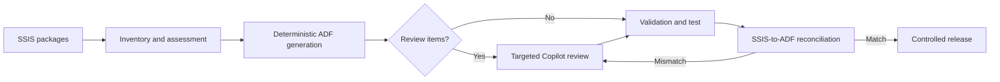

# SSIS-to-ADF Migration Accelerator

[](https://www.python.org/)
[](LICENSE)
[](https://github.com/tyrrestrup/ssis_adf_agent/actions/workflows/ci.yml)

A customer-owned workflow for migrating SQL Server Integration Services (SSIS) packages to
Azure Data Factory (ADF).

The solution uses deterministic Python rules for inventory, assessment, known conversions,
validation, and workflow gates. GitHub Copilot is reserved for uncertain logic, semantic review,
and reconciliation failures. Generated code is never treated as proof of equivalence;
reconciliation provides that evidence.

## Start here

| Audience | Document |
|---|---|
| Executives and customers | [Solution walkthrough](docs/executive/SSIS_TO_ADF_SOLUTION_WALKTHROUGH.md) or [Word version](docs/executive/SSIS_to_ADF_Solution_Walkthrough.docx) |
| Vendor and strategy evaluation | [Bitwise comparison](docs/executive/BITWISE_COMPARISON.md) or [Word version](docs/executive/Bitwise_Comparison_and_Positioning.docx) |
| Migration engineers | [Operator guide](docs/OPERATOR_GUIDE.md) |
| New users | [Setup guide](SETUP.md) |

## Quick start

```powershell
git clone https://github.com/tyrrestrup/ssis_adf_agent.git
cd ssis_adf_agent

python -m venv .venv
.\.venv\Scripts\Activate.ps1
pip install -e .

python scripts\verify_install.py
ssis-adf migrate `
  --source samples\customer_transaction_risk\customer-input\ssis `
  --workspace work\demo
```

Review:

```text
work/demo/migration_report.md
work/demo/02_assessment/ai_review_queue.json
work/demo/03_adf/
```

The first two files explain what was converted, what requires review, and which readiness gates
remain blocked.

## How it works



| Stage | Automated by the CLI | Human or Copilot contribution |
|---|---|---|
| Discover | Packages, connections, tasks, dependencies, SQL, and components | Confirm source scope |
| Assess | Complexity, gaps, dependency order, and review routing | Select target architecture and migration waves |
| Convert | ADF pipelines, linked services, datasets, data flows, triggers, and stubs | Implement unsupported or ambiguous behavior |
| Validate | Artifact checks and readiness gates | Review source-to-target semantics |
| Reconcile | Evidence state and mismatch routing | Execute comparisons and approve tolerances |
| Release | Gate enforcement and development deployment | CI/CD, parallel run, operations, and production approval |

## Customer deliverables

A migration workspace contains:

- package inventory and deterministic assessment;
- generated ADF source files;
- an explicit AI review queue;
- recorded decisions and approvals;
- validation and test evidence;
- reconciliation results;
- release and cutover evidence.

The workspace remains in the customer-controlled filesystem and can be versioned in the
customer's repository.

## Core commands

```powershell
# Inventory, assess, convert, and create the review queue
ssis-adf migrate --source <ssis-folder> --workspace work\<migration>

# View migration and gate status
ssis-adf status --workspace work\<migration>

# List or resolve review findings
ssis-adf review --workspace work\<migration>

# Validate a package and enforce the build gate
ssis-adf validate --workspace work\<migration> --package <package-key>

# Record test, assessment, or cutover evidence
ssis-adf gate --workspace work\<migration> --package <package-key> `
  --gate G3 --result pass --evidence <evidence-file> --approved-by <name>

# Record reconciliation evidence
ssis-adf reconcile --workspace work\<migration> --package <package-key> `
  --result pass --evidence <evidence-file>

# Deploy a build-approved package; triggers remain stopped
ssis-adf deploy --workspace work\<migration> --package <package-key> `
  --subscription-id <subscription-id> `
  --resource-group <resource-group> `
  --factory-name <data-factory>
```

Run `ssis-adf <command> --help` for command-specific options.

## Repository map

```text
ssis_adf_agent/                Python package and CLI
  parsers/                     DTSX readers and intermediate models
  analyzers/                   Complexity, gaps, dependencies, and patterns
  converters/                  SSIS control-flow and data-flow mappings
  generators/                  ADF artifact generation
  deployer/                    ADF deployment adapter
docs/
  OPERATOR_GUIDE.md            Detailed migration workflow and controls
  executive/                   Executive Word and Markdown documents
samples/
  customer_transaction_risk/   Runnable customer-shaped SQL Server 2022 example
  fsi/                         Synthetic 10-package financial-services corpus
scripts/verify_install.py      Installation smoke test
.vscode/*.prompt.md            Optional Copilot prompt files
```

## Samples

### Customer transaction-risk demo

[`samples/customer_transaction_risk/`](samples/customer_transaction_risk/README.md) is the
recommended end-to-end example. It includes:

- an SSDT-shaped SQL Server 2022 SSIS project;
- database creation and seed scripts;
- a fixed eight-transaction baseline;
- a deliberate lookup no-match case;
- reconciliation queries for classified, exception, and summary outputs.

### FSI package corpus

[`samples/fsi/`](samples/fsi/README.md) contains 10 deterministic synthetic packages covering
finance, AML, sanctions, payments, risk, treasury, customer data, and orchestration. No customer
code or data is included.

## Optional integrations

The CLI is the primary interface. The following are optional:

- **GitHub Copilot prompt files:** guided analysis, refactoring, deployment, and reconciliation.
- **Azure OpenAI:** draft translation of embedded C# Script Task logic. Review and completion are
  always required.
- **MCP adapter:** install `pip install -e ".[mcp]"` only for MCP-compatible clients.

## Security and operating boundaries

- Do not commit customer packages, migration workspaces, credentials, or connection secrets.
  `work/`, `.env`, and generated output are ignored by Git.
- Use Azure Key Vault or the customer's approved secret store.
- Review all generated and AI-assisted changes before deployment.
- ADF triggers are generated and deployed in a stopped state.
- The current repository is an accelerator, not a managed service or production warranty.
- Some SSIS patterns require manual implementation or architectural redesign. The CLI reports
  these as blocking findings rather than silently claiming success.
- Production readiness requires package-specific validation, testing, reconciliation, and
  customer approval.

## Development

```powershell
pip install -e ".[dev]"
pytest -q
ruff check .
python samples\fsi\tools\generate_packages.py --check
python samples\fsi\tools\validate_corpus.py
```

## License

Licensed under the [MIT License](LICENSE).
