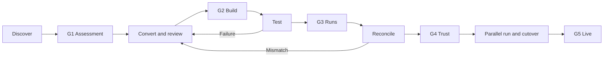

# Operator guide

This guide is for migration engineers running the SSIS-to-ADF workflow. For the customer-level
overview, read the [executive walkthrough](executive/SSIS_TO_ADF_SOLUTION_WALKTHROUGH.md).

## Operating principle

Known patterns are handled by deterministic Python code. Copilot reviews only explicit gaps and
reconciliation failures. A package is not ready because conversion completed; it is ready when
the required evidence gates pass.

## Migration lifecycle



| Gate | Required evidence |
|---|---|
| **G1 — Assessment** | Scope, dependencies, target approach, owners, and accepted risks |
| **G2 — Build** | Clean artifact validation and no unresolved review items |
| **G3 — Test** | Successful development runs, including required error paths |
| **G4 — Reconciliation** | SSIS and ADF comparisons pass within approved tolerances |
| **G5 — Cutover** | Parallel-run evidence, monitoring, rollback plan, and release approval |

## 1. Create a migration workspace

```powershell
ssis-adf migrate `
  --source D:\Customer\SSIS `
  --workspace work\customer-migration
```

The CLI creates:

```text
work/customer-migration/
  migration.json
  migration_report.md
  01_inventory/
  02_assessment/
    ai_review_queue.json
  03_adf/<package>/
  04_review/
  05_reconciliation/
  06_release/
```

Keep the workspace in a customer-controlled repository if evidence must be versioned. Do not
commit it to this public accelerator repository.

## 2. Review the assessment

Read `migration_report.md` and the analysis files under `02_assessment/`.

Confirm:

- every expected package was discovered;
- package dependencies and schedules are understood;
- connection and environment mappings are defined;
- manual or unsupported items have an owner and target approach;
- packages are grouped into dependency-aware migration waves.

Record G1 only after the assessment is approved:

```powershell
ssis-adf gate `
  --workspace work\customer-migration `
  --package <package-key> `
  --gate G1 `
  --result pass `
  --evidence <assessment-file> `
  --approved-by "<approver>"
```

## 3. Resolve review items

List open findings:

```powershell
ssis-adf review --workspace work\customer-migration
```

Work through one item at a time. Compare the original `.dtsx`, deterministic analysis, and
generated ADF assets. Record null handling, ordering, precision, joins, error paths, and dropped
rows explicitly.

Common decisions:

| SSIS pattern | Typical target |
|---|---|
| Simple source-to-target Data Flow | ADF Copy Activity |
| Complex Data Flow | ADF Mapping Data Flow or SQL-based redesign |
| Execute SQL Task | Script, Stored Procedure, or Lookup activity |
| Script Task | Azure Function or notebook with manual completion |
| Execute Package Task | Execute Pipeline activity |
| ForEach Loop | ForEach activity |
| For Loop | Initialization plus Until and increment activities |
| Local executable | Azure Function, Batch, or containerized workload |
| Linked server or `OPENQUERY` | Separate linked service and staging, external table, or elastic query |
| File System Task | Storage Copy activity or Azure Function |
| Send Mail Task | Logic App or Web activity |

After approval:

```powershell
ssis-adf review `
  --workspace work\customer-migration `
  --resolve <item-id> `
  --decision "<approved decision>" `
  --approved-by "<approver>"
```

## 4. Validate the generated build

```powershell
ssis-adf validate `
  --workspace work\customer-migration `
  --package <package-key>
```

Before accepting G2, verify:

- activity dependencies preserve success, failure, completion, expression, AND, and OR paths;
- every referenced data flow, dataset, linked service, pipeline, and function exists;
- variable and parameter types match SSIS;
- no plaintext credentials are present;
- local and UNC paths have approved cloud replacements;
- Script Task and unsupported-component stubs are implemented;
- lookup no-match and Conditional Split outputs are preserved;
- triggers remain stopped.

## 5. Deploy and test in development

Deployment is blocked until G2 passes.

```powershell
ssis-adf deploy `
  --workspace work\customer-migration `
  --package <package-key> `
  --subscription-id <subscription-id> `
  --resource-group <resource-group> `
  --factory-name <data-factory>
```

Run representative inputs and required failure cases. Record run IDs and logs. Then record G3:

```powershell
ssis-adf gate `
  --workspace work\customer-migration `
  --package <package-key> `
  --gate G3 `
  --result pass `
  --evidence <test-evidence> `
  --approved-by "<approver>"
```

## 6. Reconcile SSIS and ADF

Run both implementations against the same immutable input or equivalent business window.

Minimum comparisons should include:

| Check | Detects |
|---|---|
| Row counts by target and reject output | Dropped or duplicated rows |
| Business control totals | Precision, rounding, filters, and date selection |
| Key-set differences in both directions | Join and routing changes |
| Row hashes over material columns | Silent value changes |
| Null and datatype profiles | Conversion and default-value differences |
| Reject and error-path results | Lost exception behavior |
| File hashes or byte comparison | Fixed-width and regulated file changes |

Record the result:

```powershell
ssis-adf reconcile `
  --workspace work\customer-migration `
  --package <package-key> `
  --result pass `
  --evidence <reconciliation-evidence>
```

A failed result creates a `RECON-*` review item and returns the package to remediation.

## 7. Release

For production:

1. Promote through the customer's CI/CD process.
2. Keep triggers stopped until the approved activation step.
3. Run SSIS and ADF in parallel for the agreed period.
4. Reconcile each run.
5. Confirm monitoring, alerting, support, rollback, and ownership.
6. Record G5 and retire the SSIS schedule only after approval.

## Copilot usage

The optional `.vscode/*.prompt.md` files provide guided workflows for analysis, gap remediation,
deployment, and reconciliation. Copilot may propose and implement changes, but it must not:

- reproduce secrets;
- silently replace unsupported behavior;
- approve reconciliation differences;
- activate production triggers;
- declare semantic equivalence;
- approve production deployment.

## Current boundary

This repository provides a working CLI, deterministic conversion baseline, workflow gates,
development deployment, samples, and evidence routing. It is not a managed migration service.
Complex packages still require engineering review, target-platform decisions, runtime testing,
and customer-owned production controls.
