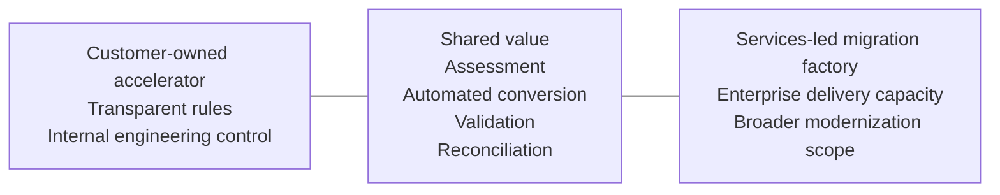
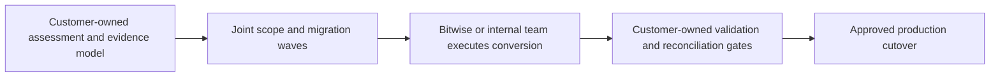

# Bitwise and the SSIS-to-ADF Migration Accelerator

## Executive comparison and positioning

**Purpose:** Compare Bitwise’s publicly described ETL modernization offering with this repository’s customer-owned SSIS-to-ADF accelerator.

**Basis:** Bitwise public materials and the supplied Bitwise context handoff, reviewed on 29 October 2026. Exact Bitwise scope, automation coverage, deliverables, pricing, and support commitments remain proposal- and SOW-dependent.

---

## 1. Executive assessment

The two approaches share the same broad migration lifecycle:

> discover → assess → convert → remediate → validate → reconcile → release

They differ primarily in **delivery model and ownership**.

| Bitwise | This solution |
|---|---|
| Enterprise services-led migration factory supported by proprietary accelerators and FulkrumAI | Customer-owned engineering accelerator built from transparent Python rules, GitHub Copilot, and evidence gates |
| Best suited to large programs that need delivery capacity, broader ETL coverage, program governance, and production support | Best suited to organizations that want control, extensibility, lower entry cost, transparent artifacts, and an internal repeatable capability |

This is not a direct product-for-product comparison. Bitwise combines technology, consulting, and managed delivery. This repository is currently a reusable accelerator that the customer or implementation partner operates.

---

## 2. Positioning at a glance

| Decision driver | Better aligned option |
|---|---|
| Large multi-tool estate requiring a delivery partner and program execution | **Bitwise** |
| Customer wants a reusable internal capability and full artifact ownership | **This solution** |
| Need to start with a low-cost, transparent SSIS proof of value | **This solution** |
| Need contractual delivery, production stabilization, DR, and support | **Bitwise** |
| Need an independent assessment and evidence model before selecting a delivery partner | **This solution** |
| Need broader migration across Informatica, DataStage, Ab Initio, SSIS, ADF, Databricks, or Fabric | **Bitwise**, subject to SOW |

---

## 3. Side-by-side capability comparison

| Dimension | Bitwise offering | This solution | Executive interpretation |
|---|---|---|---|
| **Offering type** | Commercial platform plus consulting and implementation services | Open, repository-based accelerator and workflow | Different categories; compare outcomes and ownership, not only features |
| **Primary scope** | Broad ETL and data-platform modernization | SSIS to ADF, with a focused current boundary | Bitwise is broader; this solution is intentionally narrow |
| **Discovery and dependency analysis** | Publicly positioned as a core FulkrumAI feature | Deterministic package inventory, gaps, complexity, and dependency ordering | Similar objective; Bitwise is positioned for larger estates |
| **Wave planning** | Explicit platform capability | Dependency-aware planning with Copilot-assisted wave design | Bitwise has stronger stated portfolio orchestration |
| **Conversion** | Proprietary ETL converter and agentic migration factory | Versioned Python conversion rules that generate ADF JSON | This solution offers greater implementation transparency |
| **AI role** | Agent-driven execution and learning loops | AI is limited to uncertain logic, diagnosis, and documentation | This solution emphasizes bounded AI authority |
| **Validation** | Lineage, test data, synthetic data, validation loops, and feed comparison are publicly stated | Static validation, workflow gates, targeted tests, and reconciliation specifications | Bitwise presents a broader validation platform; exact deliverables require SOW confirmation |
| **Reconciliation** | Automated output-feed comparison cited in an SSIS-to-ADF case study | Evidence-led counts, totals, keys, hashes, rejects, and mismatch routing | Both treat validation as material; this solution makes the evidence model explicit |
| **Architecture optimization** | Consulting-led redesign, including metadata-driven approaches and cost optimization | Copilot proposes options; customer approves target patterns | Bitwise brings experienced delivery teams; this solution preserves customer control |
| **Production rollout** | Implementation, DR, failover, release, and stabilization can be included | Development deployment exists; production CI/CD and cutover remain customer-led | Bitwise is stronger for turnkey execution today |
| **Transparency** | Public outcomes are visible; internal conversion rules and platform internals are proprietary | Source, rules, artifacts, decisions, and evidence are inspectable | This is a central differentiator for regulated or engineering-led customers |
| **Ownership** | Depends on contract, licensing, and delivered artifacts | Customer owns the repository, generated assets, decisions, and evidence | This solution reduces tool lock-in |
| **Support model** | Commercial delivery and support relationship | Community/internal engineering ownership; no commercial SLA in the repository | Bitwise is stronger when accountable support is required |
| **Commercial model** | Proposal/SOW-based; no universal public SSIS price card | Open-source code plus customer engineering and Azure/Copilot costs | This solution lowers entry cost but shifts responsibility to the customer |
| **Maturity** | Established services organization with published case studies | Early-stage accelerator with working samples and documented limitations | Bitwise has stronger market maturity; this solution has greater adaptability |

---

## 4. Where the approaches are similar

Both approaches recognize that ETL migration is more than syntax conversion.

1. **Assessment before build.** Inventory, dependencies, complexity, and target design must be understood first.
2. **Automation plus engineering judgment.** Common patterns can be converted; scripts, unsupported components, and redesign decisions require intervention.
3. **Native target implementation.** The goal is ADF-oriented assets rather than simply hosting SSIS unchanged.
4. **Validation is part of migration.** Source and target outcomes must be compared before sign-off.
5. **Phased rollout.** Complex estates move in waves, with controlled deployment and stabilization.
6. **Continuous improvement.** Repeated findings should become reusable rules, patterns, and accelerators.

---

## 5. Relative strengths

### Bitwise strengths

- Broader ETL modernization scope and enterprise delivery capacity.
- Commercial accountability through an engagement and SOW.
- Experience with migration factories, release management, DR, and stabilization.
- Publicly stated capabilities for wave planning, automated conversion, validation, synthetic data, and feedback loops.
- Ability to combine tooling with architecture, engineering, testing, and program management.
- Microsoft-aligned modernization positioning across Azure and Fabric.

### This solution’s strengths

- Customer ownership of source code, generated assets, decisions, and evidence.
- Transparent, versioned conversion logic that can be inspected and changed.
- Deterministic handling of known mappings, reducing unnecessary AI use and variability.
- Explicit review queue rather than hidden assumptions or silent fallbacks.
- Evidence-based gates that separate “generated,” “runs,” and “reconciles.”
- Easy integration into the customer’s Git, Copilot, Azure, and CI/CD standards.
- Low-friction entry point for discovery, proof of value, and internal capability building.
- A neutral evidence pack that can be retained even if a different implementation partner completes the migration.

---

## 6. Relative weaknesses and risks

### Bitwise considerations

- Exact automated conversion coverage is not established by public material alone.
- Scope, artifact ownership, validation depth, support, warranties, and pricing require proposal-level confirmation.
- Proprietary platform logic may provide less visibility than customer-maintained conversion rules.
- A services-led model can increase dependency on the vendor for future extensions or exception handling.
- Published case-study outcomes are client-specific and should not be treated as universal guarantees.

### This solution’s current limitations

- Narrower SSIS-to-ADF scope and lower maturity than an enterprise migration provider.
- Conversion and static-validation coverage are incomplete for some SSIS patterns.
- Generic reconciliation execution and portfolio reporting are not yet fully productized.
- Production CI/CD, DR, operational monitoring, and cutover are customer-led.
- No commercial SLA, managed service, or dedicated migration workforce.
- Successful adoption requires an engineering owner who can review code and operate the process.

---

## 7. Where this solution adds value

The strongest value is not attempting to replicate an entire consulting firm. It is giving the customer a transparent migration foundation that can be used independently or alongside a partner.

| Value-add role | How it helps |
|---|---|
| **Independent assessment layer** | Establishes package scope, complexity, dependencies, and risks before commercial estimation |
| **Customer-owned control plane** | Keeps workflow state, decisions, approvals, and evidence in the customer’s repository |
| **Transparent conversion baseline** | Shows exactly what was generated and which rules were applied |
| **AI cost control** | Uses deterministic code for known patterns and reserves Copilot for uncertain logic |
| **Acceptance framework** | Defines package-level gates and reconciliation evidence regardless of who performs the migration |
| **Partner governance** | Gives the customer a consistent way to review Bitwise or another partner’s delivered artifacts |
| **Reusable internal capability** | Converts repeated findings into customer-specific rules and playbooks |
| **Exit-option protection** | Preserves knowledge and artifacts if the delivery partner changes |

---

## 8. Best-fit operating models

| Scenario | Recommended model |
|---|---|
| Fewer packages, strong internal engineering team, need for control and extensibility | Use this solution directly |
| Large or multi-platform estate, fixed deadline, limited internal capacity | Use Bitwise or another enterprise delivery partner |
| Customer wants vendor execution but stronger transparency and acceptance evidence | Use Bitwise for delivery and this solution as the customer-owned governance layer |
| Uncertain business case or vendor scope | Run this solution first for inventory and proof of value, then request a priced proposal |
| Highly regulated migration requiring traceable decisions | Use the evidence model from this solution; add commercial delivery support as required |

### Practical hybrid model

In this model, Bitwise provides scale and delivery experience while the customer retains the migration record, acceptance criteria, and long-term operating knowledge.

---

## 9. Recommended proof-of-value evaluation

Evaluate both approaches on the same representative package set rather than comparing presentations.

### Suggested package set

- one simple SQL-oriented package;
- one package with a complex data flow and error outputs;
- one package with scripts, loops, or external dependencies;
- one parent/child orchestration package;
- one package with a reliable SSIS baseline for reconciliation.

### Scorecard

| Measure | Weight |
|---|---:|
| Inventory and dependency completeness | 15% |
| Conversion coverage and correctness | 20% |
| Transparency of assumptions and unsupported behavior | 15% |
| Test and reconciliation depth | 20% |
| Engineering effort to reach acceptance | 10% |
| Operability, security, and deployment readiness | 10% |
| Commercial clarity and total cost of ownership | 10% |

Require each participant to provide:

- generated assets;
- unresolved-item list;
- effort and assumptions;
- test and reconciliation evidence;
- production-readiness gaps;
- ownership, licensing, and support terms.

---

## 10. Due-diligence questions for Bitwise

1. Which SSIS task and data-flow patterns are fully automated, partially automated, or manual?
2. How are unsupported components represented, and can conversion ever complete with placeholders?
3. What source inventory, lineage, and dependency artifacts are delivered to the customer?
4. What reconciliation checks are generated and executed by default?
5. Are conversion rules, mappings, and assumptions visible to the customer?
6. Who owns generated code, configuration, test assets, and validation results?
7. What is included for DR, production cutover, warranty, and stabilization?
8. How are active SSIS changes handled during a migration wave?
9. How is pricing structured: package, complexity, wave, fixed scope, platform license, or time and materials?
10. Can the customer continue operating and extending the delivered solution without Bitwise?

---

## 11. Recommendation

Use the two approaches according to the operating need:

- choose **Bitwise** when the primary requirement is enterprise delivery capacity, broader platform coverage, contractual execution, and production support;
- choose **this solution** when the primary requirement is customer ownership, transparency, extensibility, and a controlled SSIS-to-ADF starting point;
- use a **hybrid model** when the customer wants partner scale without surrendering the assessment, evidence, and acceptance framework.

The most defensible next step is a common proof of value with package-level acceptance criteria and reconciliation evidence.

---

## Sources

1. Bitwise, “FulkrumAI,” https://www.bitwiseglobal.com/platforms/fulkrumai
2. Bitwise, “Accelerated SSIS ETL Migration to Azure Data Factory,” https://www.bitwiseglobal.com/insights/accelerated-ssis-etl-migration-to-azure-data-factory
3. Bitwise, “Automated ETL Migration to Azure for Accelerated Data Warehouse Modernization,” https://www.bitwiseglobal.com/insights/automated-etl-migration-to-azure-for-accelerated-data-warehouse-modernization
4. Bitwise, “Microsoft Partnership,” https://www.bitwiseglobal.com/partners/microsoft
5. Supplied `Bitwise_Context_Handoff.txt`, dated 29 October 2026

