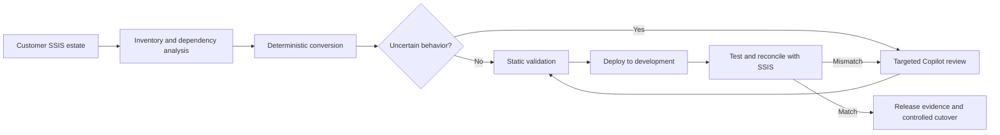
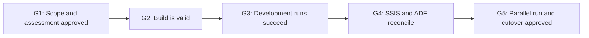

# SSIS-to-ADF Migration Accelerator

## Executive walkthrough

**Purpose:** Help a customer move SSIS packages to Azure Data Factory with a repeatable process, explicit human decisions, and evidence that the new pipelines preserve the intended behavior.

**Core proposition:** Automate what is predictable. Use AI only where interpretation is required. Treat reconciliation—not generated code—as the proof of migration.

---

## 1. What the customer experiences

The customer points the solution to a folder, repository, or supported SQL Server source containing SSIS packages. One command creates the initial inventory, assessment, ADF assets, and review queue.

```powershell
ssis-adf migrate --source <ssis-source> --workspace work/<migration-name>
```



The customer does not receive a black-box conversion result. They receive the generated assets, the assumptions, the unresolved items, and the evidence required to approve each package.

---

## 2. What the customer provides

| Input | Purpose |
|---|---|
| SSIS projects and `.dtsx` packages | Source logic to inventory and convert |
| SQL Agent or schedule metadata, when available | Preserve orchestration and timing |
| Connection and environment mappings | Replace on-premises endpoints with Azure targets |
| Representative test data or a controlled business-date window | Run SSIS and ADF against equivalent inputs |
| Business owners and acceptance criteria | Approve intentional differences and production readiness |

Credentials are not embedded in reports or generated assets. Secret references should be mapped to Azure Key Vault or the customer’s approved secret-management standard.

---

## 3. End-to-end customer journey

| Stage | What happens | Primary owner | Customer output |
|---|---|---|---|
| **1. Intake** | Create a migration workspace and capture the source package set | Customer + CLI | Versioned source scope |
| **2. Discover** | Parse packages, tasks, data flows, variables, connections, schedules, and dependencies | Deterministic engine | Estate inventory |
| **3. Assess** | Score complexity, classify conversion paths, identify unsupported or uncertain behavior, and group dependent packages | Engine + migration lead | Assessment and wave plan |
| **4. Convert** | Generate ADF pipelines, linked services, datasets, data flows, triggers, parameters, and code stubs for known patterns | Deterministic engine | ADF baseline |
| **5. Resolve** | Review only the explicit gaps: scripts, ambiguous SQL, error paths, lookup behavior, ordering, precision, or architecture choices | Copilot + engineer | Reviewed changes and decision log |
| **6. Validate** | Check artifact structure, references, expressions, dependencies, policies, and unresolved findings | Engine | Build-readiness result |
| **7. Test and reconcile** | Run SSIS and ADF on equivalent inputs; compare counts, totals, keys, hashes, rejects, and control-flow outcomes | Customer + engine + Copilot | Reconciliation evidence |
| **8. Release** | Promote approved assets, run in parallel, activate triggers, and retire the SSIS workload | Customer platform team | Release pack and cutover approval |

Packages move through the process in dependency-aware waves. A package cannot advance because the generated code “looks right”; it advances only when the required gate evidence exists.

---

## 4. How work is divided

| Deterministic Python engine | GitHub Copilot | Customer team |
|---|---|---|
| Parses SSIS and creates a canonical model | Explains unfamiliar or ambiguous logic | Defines target architecture and operating constraints |
| Applies versioned conversion rules | Proposes the smallest safe remediation | Reviews and approves decisions |
| Generates repeatable ADF assets | Drafts code for scripts or unsupported patterns | Provides environments, identities, and test data |
| Creates the review queue | Diagnoses failed tests and reconciliation mismatches | Executes business acceptance and cutover |
| Enforces workflow gates | Produces concise technical explanations | Owns production approval |
| Records evidence and status | Does not declare equivalence or approve production | Signs off on accepted outcomes |

This division limits AI usage and keeps production decisions with accountable people.

---

## 5. Trust model



| Gate | Decision | Minimum evidence |
|---|---|---|
| **G1 — Assessment** | Is the migration approach understood and owned? | Inventory, risks, dependencies, owners, target pattern |
| **G2 — Build** | Is the ADF implementation structurally complete? | Clean validation, resolved findings, reviewed dependencies |
| **G3 — Test** | Does the pipeline execute in development? | Successful runs, expected error-path behavior, run IDs |
| **G4 — Reconciliation** | Does it preserve required business behavior? | Counts, totals, key differences, row hashes, accepted tolerances |
| **G5 — Cutover** | Is it safe to make ADF the production system of record? | Clean parallel runs, monitoring, rollback plan, approval |

### Reconciliation is the decisive control

Typical comparisons include:

- row counts for successful, rejected, inserted, updated, and deleted records;
- control totals by business dimension;
- key-set differences in both directions;
- deterministic hashes over material columns;
- null, precision, rounding, and watermark checks;
- branch, error-path, and reject-path outcomes;
- runtime and service-level comparisons where required.

A mismatch creates a new review item and returns the package to remediation. It is not converted into a warning or silently accepted.

---

## 6. What the customer receives

| Deliverable | Contents | Business value |
|---|---|---|
| **Estate inventory** | Packages, jobs, dependencies, connections, components, and schedules | Establishes scope and migration waves |
| **Assessment report** | Complexity, risks, supported patterns, assumptions, and decisions | Makes effort and risk visible before build |
| **ADF implementation** | Pipelines, linked services, datasets, data flows, parameters, triggers, and supporting code | Provides deployable source-controlled assets |
| **AI review queue** | Only logic that requires interpretation or design judgment | Focuses engineering time and AI cost |
| **Decision log** | Approved mappings, exceptions, owners, and rationale | Creates traceability and auditability |
| **Validation and test evidence** | Static checks, deployment results, and execution history | Demonstrates technical readiness |
| **Reconciliation pack** | Comparison rules, results, differences, tolerances, and sign-off | Demonstrates behavioral equivalence |
| **Release pack** | Deployment log, cutover checklist, rollback plan, and approvals | Supports controlled production transition |

All assets remain in the customer’s repository and Azure environment.

---

## 7. Deployment and operating model

The solution is CLI-first. It can be run by a migration engineer directly or invoked by Copilot in agent mode. MCP is optional and is not required for the core workflow.

```text
Customer workstation or build agent
  ├─ SSIS source packages
  ├─ ssis-adf CLI and deterministic rules
  ├─ Migration workspace and evidence
  └─ GitHub Copilot for targeted review
              │
              ▼
Customer Azure subscription
  ├─ Azure Data Factory
  ├─ Azure Key Vault
  ├─ Data stores and integration runtime
  └─ Monitoring and CI/CD
```

Recommended controls:

- run the engine inside the customer’s controlled environment;
- keep customer packages and generated workspaces outside the public repository;
- store secrets in Key Vault;
- deploy triggers in a stopped state;
- require reviewed pull requests for generated and AI-assisted changes;
- preserve source, rule-set, decision, test, and reconciliation versions.

---

## 8. Current capability and intended product experience

The repository is a working accelerator, not yet a fully managed enterprise migration platform.

| Capability | Available now | Target customer experience |
|---|---|---|
| Local package discovery and parsing | Yes | Add complete SSISDB, environment, and job discovery |
| Inventory, complexity, gaps, and dependency analysis | Yes | Add estate dashboards and automated wave optimization |
| Deterministic ADF generation | Yes, with documented coverage limits | Expand versioned conversion rules and connectors |
| Focused AI review queue | Yes | Add reusable remediation playbooks and approved rule promotion |
| Workflow state and readiness gates | Yes | Add richer approvals, resumability, and portfolio reporting |
| Static artifact validation | Yes, with known limitations | Add full reference, schema, expression, and policy validation |
| Development deployment | Yes | Add production-grade CI/CD templates and environment promotion |
| Reconciliation workflow | Evidence recording and sample implementations | Add reusable execution adapters and generated reports |
| Customer portal and managed service | No | Optional future interface; CLI remains the source of truth |

No output should be represented as production-ready until its package-specific review, testing, and reconciliation are complete.

---

## 9. Example outcome

For the included customer transaction-risk sample, the solution:

1. finds and parses the SSIS package;
2. generates an ADF baseline without using AI;
3. identifies three review items: lookup no-match routing, conditional-split ordering, and aggregate grouping;
4. blocks build approval until those items are resolved;
5. validates the generated assets;
6. compares SSIS and ADF outputs across counts, amounts, keys, and hashes;
7. records the evidence required for release.

The same operating model applies to a broader estate, with packages grouped into migration waves.

---

## 10. Executive takeaway

This solution is designed to be a **customer-owned migration control plane**, not a one-click code converter. Its value is the combination of:

- repeatable deterministic conversion;
- targeted use of AI for the work that requires judgment;
- transparent assumptions and decisions;
- reconciliation-led proof;
- customer ownership of code, evidence, and operating knowledge.

The practical next step is a controlled proof of value using a representative package set: one simple package, one transformation-heavy package, and one package with scripts or complex error handling.

